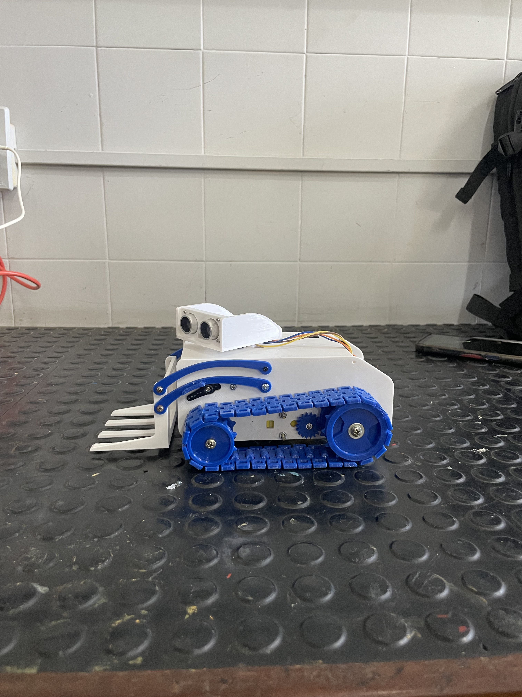

# Robô Empilhadeira: Robô sobre Esteiras com Garra Frontal

<p align="center">
  
</p>

<p align="center">
  <strong>Robô móvel controlado por Bluetooth Low Energy, com esteiras, garra frontal e cabeça articulada</strong>
</p>

<p align="center">
  
  
  
  
</p>

---

## 📖 Sobre o Projeto

O **Robô Empilhadeira** é um robô sobre esteiras com uma garra frontal para movimentar pequenos objetos. O projeto combina peças impressas em 3D, motores, servos e firmware para Arduino Nano ESP32.

O robô é controlado por Bluetooth Low Energy (BLE). O firmware permite comandar o deslocamento, ajustar a velocidade, abrir e fechar a garra e ativar o movimento automático da cabeça. O sensor ultrassônico HC-SR04 faz leituras de distância; o desvio automático de obstáculos está desativado na versão atual do código.

---

## 🌟 Principais Recursos

- 🤖 Chassi móvel sobre esteiras com garra frontal.
- 📱 Controle sem fio por Bluetooth Low Energy.
- ↔️ Comandos para avançar, recuar e girar para os lados.
- 🦾 Abertura e fechamento da garra por botões dedicados.
- 👀 Movimento aleatório da cabeça, ativado ou desativado pelo controle.
- 🎚️ Ajuste da velocidade dos motores entre 0 e 100%.
- 📡 Leitura de distância com sensor ultrassônico HC-SR04.
- 🛑 Comandos de parada e parada de emergência.

---

## 📸 Demonstração

<p align="center">
  
</p>

O repositório ainda não contém um vídeo demonstrativo. Quando disponível, ele poderá ser adicionado aqui.

---

## 🧩 Arquivos 3D

A pasta [`arquivos3D`](arquivos3D) está preparada para receber os arquivos de impressão, mas ainda não contém arquivos STL neste repositório. O modelo de referência pode ser encontrado na página original do [TRACK ROBOT Builder3D WITH FRONTAL GRIPPER](https://makerworld.com/pt/models/763638-track-robot-builder3d-with-frontal-gripper?from=search#profileId-698612).

---

## 🏗️ Estrutura do Repositório

```text
.
├── arquivos3D/                 # Pasta preparada para os arquivos STL
├── Firmware/
│   └── roboEmpilhadeira.ino    # Firmware para Arduino Nano ESP32
├── logo_vulkaris.png
├── robo1.jpg                   # Foto frontal do robô
├── robo2.jpg                   # Foto lateral do robô
└── README.md
```

---

## 🛠️ Como Utilizar

### Impressão e montagem

1. Baixe os arquivos 3D na página do modelo original no MakerWorld e confira as instruções e condições de uso publicadas pelo criador.
2. Coloque os arquivos STL em `arquivos3D/` e abra-os no fatiador de sua preferência.
3. Ajuste orientação, suportes e parâmetros de impressão conforme sua impressora e material.
4. Monte o chassi, os motores, a garra, os servos e a eletrônica.
5. Faça as ligações conforme os pinos definidos no firmware e a documentação dos módulos utilizados.

O repositório não inclui esquema elétrico nem uma lista fechada de materiais. Confira também a compatibilidade elétrica entre a alimentação, o driver de motores, os servos e a placa antes de conectar o circuito.

### Firmware

O firmware está em [`Firmware/roboEmpilhadeira.ino`](Firmware/roboEmpilhadeira.ino). Ele foi escrito para Arduino Nano ESP32 usando a versão 2.x do pacote de placas Arduino ESP32. A comunicação de controle é feita por BLE; o nome anunciado pelo robô é `Vulkaris Nano`. O repositório não inclui um aplicativo de controle.

Para carregar o programa:

1. Abra `Firmware/roboEmpilhadeira.ino` na Arduino IDE.
2. Instale o pacote de placas Arduino ESP32 2.x e selecione Arduino Nano ESP32.
3. Selecione a porta correspondente e carregue o sketch.
4. Conecte-se ao dispositivo BLE `Vulkaris Nano` usando um controlador compatível com o protocolo descrito abaixo.

#### Comandos BLE

Cada comando enviado contém quatro bytes: `[versão, sequência, comando, valor]`. A versão atual é `1`. O firmware envia uma confirmação BLE com `[versão, sequência, resultado]`.

| Comando | Código | Valor | Ação |
|---|---:|---:|---|
| Parar | `0x00` | `0` | Para motores, servos e movimento automático da cabeça. |
| Avançar | `0x01` | `1` | Move o robô para frente. |
| Recuar | `0x02` | `1` | Move o robô para trás. |
| Virar à esquerda | `0x03` | `1` | Gira o robô para a esquerda. |
| Virar à direita | `0x04` | `1` | Gira o robô para a direita. |
| Abrir garra (A1) | `0x10` | `1` para acionar, `0` para soltar | Move a garra em direção à abertura estimada de 120°. |
| Fechar garra (A2) | `0x11` | `1` para acionar, `0` para soltar | Move a garra em direção à posição fechada estimada de 0°. |
| Ativar cabeça automática (A3) | `0x12` | `1` | Ativa movimentos aleatórios da cabeça. |
| Desativar cabeça automática (A4) | `0x13` | `1` | Desativa o movimento da cabeça. |
| Ajustar velocidade | `0x20` | `0` a `100` | Define a velocidade dos motores em porcentagem. |
| Parada de emergência | `0x7F` | `1` | Para o robô e bloqueia os demais comandos até o rearme. |
| Rearmar | `0x7E` | `1` | Libera os comandos após a parada de emergência. |
| Slider legado | `0x21` | `0` a `180` | Aceito pelo protocolo, mas não movimenta a garra. |

UUIDs BLE usados pelo firmware:

| Característica | UUID |
|---|---|
| Serviço | `f3641400-00b0-4240-ba50-05ca45bf8abc` |
| Escrita de comandos | `f3641401-00b0-4240-ba50-05ca45bf8abc` |
| Notificações de confirmação | `f3641402-00b0-4240-ba50-05ca45bf8abc` |

#### Mapeamento de pinos

| Função | Pino |
|---|---:|
| PWM do motor esquerdo (ENA) | D5 |
| Direção do motor esquerdo (IN1/IN2) | D3 / D4 |
| PWM do motor direito (ENB) | D6 |
| Direção do motor direito (IN3/IN4) | D11 / D9 |
| Sensor ultrassônico — TRIG / ECHO | D7 / D8 |
| Servo da garra | D13 |
| Servo da cabeça | D12 |

O firmware usa PWM de 20 kHz e resolução de 8 bits para os motores. A distância medida pelo HC-SR04 é atualizada no código, mas não aciona desvio automático nesta versão.

---

## ⚙️ Tecnologias e Componentes

- Arduino Nano ESP32 com pacote de placas Arduino ESP32 2.x.
- Driver de motores L298N e dois motores DC para o sistema de esteiras.
- Dois servos de rotação contínua para a garra e a cabeça, conforme indicado nos comentários do firmware.
- Sensor ultrassônico HC-SR04.
- Peças mecânicas impressas em 3D.
- Bluetooth Low Energy para comunicação com o controle.
- Bibliotecas `Servo` e BLE fornecidas pelo ambiente Arduino ESP32.

Os componentes de alimentação, fixadores e dimensões das peças dependem da montagem. Consulte a página do modelo original para os detalhes mecânicos e materiais recomendados pelo criador.

---

## 🙏 Créditos

- **Modelo 3D de referência:** [TRACK ROBOT Builder3D WITH FRONTAL GRIPPER](https://makerworld.com/pt/models/763638-track-robot-builder3d-with-frontal-gripper?from=search#profileId-698612), criado por **MauricioDUARTE** no MakerWorld.
- **Firmware e integração eletrônica deste repositório:** projeto Vulkaris.

---

## 📄 Licença

Este repositório ainda não possui um arquivo `LICENSE`. Consulte a licença e as condições indicadas na página do modelo original antes de redistribuir ou publicar arquivos 3D derivados.
